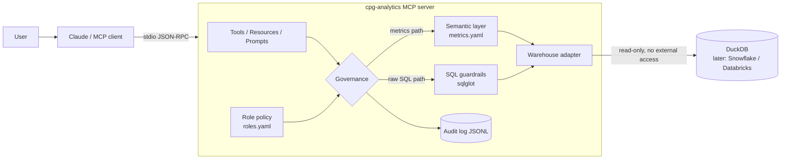

# Architecture

## Request paths

1. **Governed metric path (preferred).** `get_metric(metrics, group_by, filters, dates)`
   → role may use the metric? → dimensions in the source's allowlist? → SQL built from
   the approved expression, filter values bound as parameters → row cap + timeout → audit.
2. **Ad-hoc SQL path (fallback).** `run_sql(sql)` → parse → one SELECT, no forbidden nodes or
   functions → tables allowed for role → no restricted columns / unsafe `SELECT *` → wrapped
   with a LIMIT → timeout → audit.

## Design decisions

| Decision | Why |
|---|---|
| Semantic layer over text-to-SQL | LLMs write plausible but subtly wrong KPI SQL. Metrics with one definition remove that error class and make answers reproducible. |
| sqlglot AST checks, not regex | Regex guardrails are bypassable (comments, casing, CTEs). The AST is what the engine will execute. |
| Defense in depth | Even if a guardrail is bypassed, the connection is read-only with external access off. |
| Role from env locally | Keeps the demo simple. In production the role comes from OAuth token claims on the streamable HTTP transport. |
| Errors explain policy | A rejected query tells the model *why* and *what to use instead*, so the agent self-corrects instead of retrying blindly. |
| Lazy warehouse connection | The server starts and lists tools even if the database is down. |
| Logs to stderr | stdout belongs to the stdio transport. |
